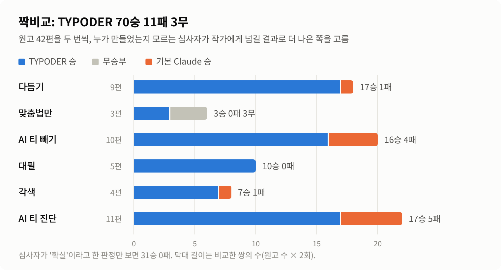
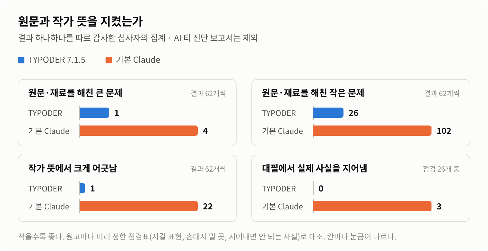

# TYPODER Korean Editor

**재료가 있는 한국어 글쓰기를 맡는 Claude 편집·집필 스킬입니다.**

이미 쓴 원고를 다듬고, 메모와 자료로 필자의 글을 대신 쓰고, 시놉시스나 원작으로 소설·대본을 씁니다. 쓰기 전에 글 전체를 읽고, 작가만 아는 것은 먼저 묻습니다. 다 쓴 뒤에는 따로 부른 검수자가 원문·재료와 대조해, 사실과 뜻이 바뀐 곳을 바로잡습니다.

- 만든 이: **TYPODER**
- 블로그: **[blog.naver.com/typoder](https://blog.naver.com/typoder)** (만든 과정과 새 소식)
- 현재 버전: **7.1.5** ([zip 내려받기](https://github.com/bakunakim/typoder-korean-editor/raw/main/dist/typoder-korean-editor-7.1.5.zip))
- 이전 이름: TYPODER Korean Editorial Pro (`typoder-korean-editorial-pro`)

## 무엇을 하나

| 갈래 | 이런 요청에 | 하는 일 |
|---|---|---|
| **윤색** | "다듬어 줘", "맞춤법만 봐 줘", "AI 티 빼 줘" | 교정·교열·윤문·퇴고를 합니다. 사람이 쓴 글은 필자의 목소리를 지키고, AI가 쓴 글은 되풀이되는 꼴과 어디에나 붙는 문장을 걷어 냅니다. |
| **대필** | "이 메모로 자소서 써 줘", "보도자료로 만들어 줘" | 재료와 작가의 답만으로 씁니다. 모르는 사실은 지어내지 않고, 자리 표시와 확인 요청으로 남깁니다. |
| **각색** | "이 시놉시스로 1화 써 줘", "이 소설을 시나리오로 바꿔 줘" | 재료가 정한 사건·관계·결말을 지키며 소설·웹소설·시나리오를 씁니다. 새로 정한 설정은 따로 알립니다. |
| **검토만** | "AI 같은지 봐 줘", "고치지 말고 문제만 알려 줘" | 원문을 고치지 않고 진단·교정 보고서를 씁니다. |

- **Word(.docx)** 원고는 '변경 내용 추적' 파일로 돌려줍니다. Word에서 고친 곳마다 수락·거절할 수 있습니다.
- **한글(.hwpx)** 원고는 빨간펜 교정본으로 돌려줍니다.
- **연재·장편**은 회차 사이의 이름·호칭·용어가 맞는지 점검합니다.

재료 없이 처음부터 짓는 창작, 아이디어 내기, 번역, 요약, 코드 리뷰에는 쓰지 않습니다.

## 이렇게 일합니다

1. **글 전체를 먼저 읽습니다.** 누가 쓴 글인지(사람·AI), 어떤 일인지(윤색·대필·각색), 어느 장르인지부터 가립니다.
2. **필요한 것만 묻습니다.** 분량, 고칠 폭, 꼭 지킬 표현, 정해 둔 설정처럼 작가만 아는 것이 비어 있을 때만 한 번에 묶어 묻습니다. 맞춤법만 고치는 요청처럼 물을 필요가 없으면 묻지 않습니다.
3. **쓰거나 고칩니다.** 사람이 쓴 글과 AI가 쓴 글, 초안과 완성본을 다르게 다룹니다.
4. **따로 검수합니다.** 쓴 사람이 아닌 검수자가 원문·재료와 결과를 대조해, 바뀐 사실·뜻이나 지어낸 내용만 고칩니다.
5. **알릴 것을 알립니다.** 바꾼 곳, 짐작한 것, 새로 정한 것, 작가가 확인할 것을 결과와 함께 돌려줍니다.

## 설치

[`typoder-korean-editor-7.1.5.zip`](https://github.com/bakunakim/typoder-korean-editor/raw/main/dist/typoder-korean-editor-7.1.5.zip)을 받습니다(저장소의 `dist/` 폴더에 있습니다). 압축 안의 폴더 이름(`typoder-korean-editor`)은 바꾸지 마세요. 스킬 이름과 같아야 합니다.

### Claude 앱 (웹·데스크톱)

1. 설정에서 **코드 실행과 파일 만들기**가 켜져 있는지 확인합니다.
2. **Settings > Capabilities > Skills**에서 **Upload skill**을 눌러 zip을 올립니다.
3. 예전 이름(`typoder-korean-editorial-pro`)을 올려 둔 적이 있으면 그것은 꺼 주세요. 둘 다 켜 두면 같은 요청에 두 스킬이 겹칩니다.

스킬은 Pro, Max, Team, Enterprise 요금제에서 쓸 수 있습니다. 자세한 것은 Anthropic의 [Using Skills in Claude](https://support.claude.com/en/articles/12512180-using-skills-in-claude)를 보세요.

### Claude Code

```bash
# 내 모든 프로젝트에서 쓰기
mkdir -p ~/.claude/skills
cp -r typoder-korean-editor ~/.claude/skills/

# 한 프로젝트에서만 쓰기
mkdir -p .claude/skills
cp -r typoder-korean-editor .claude/skills/
```

### 필요한 것

- Python 3.8 이상과 `lxml`
- LibreOffice와 Poppler가 있으면 Word 결과를 그림으로 그려 한 번 더 확인합니다(없어도 됩니다).

## 쓰는 예

```
이 보고서 다듬어 줘. (파일 첨부)
→ 누가 썼는지, 어디까지 고칠지 등 비어 있는 것만 묻고, 답을 받으면 고칩니다.

AI 티 빼 줘. 묻지 말고 알아서.
→ 묻지 않고 기본값으로 고친 뒤, 짐작한 것을 첫머리에 알립니다.

이 메모로 사보에 낼 에세이 써 줘. 1,600자 정도.
→ 재료만으로는 분량이 모자랄 것 같으면 쓰기 전에 고르게 합니다.
  · 재료만으로: 지어내지 않고 쓴 뒤, 모자란 분량을 알립니다.
  · 알아서: 재료의 사건에 대한 생각·느낌과 작은 묘사로만 채우고, 넣은 것을 알립니다.
  · 지어 채워: 장면·경험을 지어 채우되, 지어낸 것을 하나씩 적어 알립니다.
    수치·실명·연락처·인용·실적은 어느 경우에도 지어내지 않습니다.
```

## 벤치마크 (7.1.5)

같은 요청과 원고를 TYPODER Korean Editor와 기본 Claude(스킬 없음)에 맡기고, 누가 만들었는지 모르는 AI 심사자가 비교했습니다. 원고는 여섯 갈래 42편을 두 번씩 돌렸습니다. 원고마다 작가가 알고 원하는 것(분량, 형식, 정해 둔 설정, 고칠 폭)을 따로 정해 두고, 질문에는 그것만 아는 작가 역할 에이전트가 답했습니다. 기본 Claude는 묻지 않고 바로 작업했습니다.

<picture>
  <source media="(prefers-color-scheme: dark)" srcset="docs/benchmark/images/pairwise-dark.png">
  
</picture>

<picture>
  <source media="(prefers-color-scheme: dark)" srcset="docs/benchmark/images/audit-dark.png">
  
</picture>

| 항목 | TYPODER Korean Editor | 기본 Claude |
|---|---|---|
| 짝비교 84쌍 | **70승** | 11승 (무 3) |
| 심사자가 '확실'이라 한 판정 | **31승** | 0승 |
| 원문·재료를 해친 큰 문제 (결과 62개) | **1** | 4 |
| 원문·재료를 해친 작은 문제 | **26** | 102 |
| 작가 뜻에서 크게 어긋남 | **1** | 22 |
| 대필에서 실제 사실을 지어냄 (점검 26개) | **0** | 3 |
| 점수: 원문 보호 / 작가 뜻 / 글 품질 (5점 만점) | **4.68 / 4.76 / 4.45** | 4.16 / 4.02 / 4.10 |

**알아 둘 점**
- 심사자도 AI입니다. 판마다 심사자를 새로 뽑아, 같은 결과도 점수가 조금씩 달라집니다.
- '작가 뜻' 차이에는 질문할 기회의 몫이 들어 있습니다. 다만 질문이 없던 갈래(맞춤법만·AI 티 빼기·AI 티 진단)만 보아도 36승 9패 3무입니다.
- 토큰은 더 씁니다. 쓰는 단계만 기본 Claude의 약 1.4배이고, 따로 부르는 검수까지 치면 약 2.0~2.4배로 추정합니다.
- 진 경우와 남은 약점, 판별 추이는 [벤치마크 보고서](docs/benchmark/README.md)에 정리했습니다.

## 저장소 구성

```
typoder-korean-editor/      스킬 폴더 (SKILL.md, references/, scripts/)
docs/benchmark/             7.1.5 벤치마크 보고서와 그래프
dist/                       설치용 zip
CHANGELOG.md                바뀐 것
LICENSE                     MIT
```

## 소식과 문의

만든 과정과 새 버전 소식은 TYPODER 블로그에 올립니다: **[blog.naver.com/typoder](https://blog.naver.com/typoder)**

버그나 제안은 이 저장소의 [Issues](../../issues)에 남겨 주세요.

## 라이선스

[MIT](LICENSE) © 2026 TYPODER
