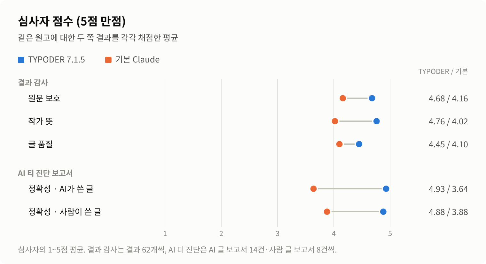
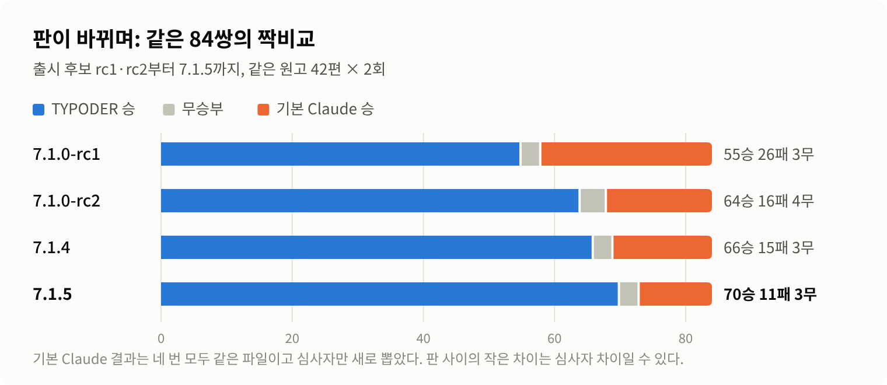

# TYPODER Korean Editor 7.1.5 벤치마크

2026년 10월에 TYPODER Korean Editor 7.1.5와 기본 Claude(스킬 없음)를 블라인드로 견준 결과입니다. 시험 원고는 공개하지 않습니다.

## 한눈에

- **짝비교 84쌍: TYPODER 70승, 기본 Claude 11승, 무승부 3.** 심사자가 '확실'이라고 한 판정만 보면 31승 0패입니다. 진 11번은 모두 '약간' 차이였습니다.
- **원문·재료를 해친 큰 문제: 1건 대 4건.** 결과 62개씩을 점검표로 대조한 값입니다.
- **작가 뜻에서 크게 어긋난 곳: 1곳 대 22곳.**
- **대필에서 실제 세계의 사실을 지어낸 것: 0 대 3.** 점검 항목 26개 기준입니다.
- **토큰은 더 씁니다.** 쓰는 단계만 기본 Claude의 약 1.4배이고, 따로 부르는 검수까지 치면 약 2.0~2.4배로 추정합니다.

<picture>
  <source media="(prefers-color-scheme: dark)" srcset="images/pairwise-dark.png">
  
</picture>

## 어떻게 쟀나

- **원고:** 여섯 갈래 42편입니다. 다듬기 9, 맞춤법만 3, AI 티 빼기 10, 대필 5, 각색 4, AI 티 진단 11편입니다. AI가 쓴 글과 사람이 쓴 글을 섞었습니다.
- **작가 정보:** 원고마다 작가가 알고 원하는 것(분량, 형식, 정해 둔 설정, 고칠 폭)을 따로 정해 두었습니다. TYPODER가 질문하면, 그 정보만 아는 작가 역할 에이전트가 답했습니다.
- **두 번씩:** 원고마다 두 번씩 돌려 결과 짝 84개를 만들었습니다.
- **TYPODER:** 스킬 절차대로 진행했습니다. 읽고, 필요하면 묻고, 쓰거나 고친 뒤, 따로 부른 검수자가 원문·재료와 대조하고, 마지막으로 작가에게 보낼 말을 정리했습니다.
- **기본 Claude:** 같은 요청과 원고를 받아 스킬 없이 바로 작업했습니다. 묻지 않았습니다.
- **심사:** 누가 만들었는지 모르는 AI 심사자가 작가 정보를 보고 판단했습니다. A·B 위치는 무작위입니다. 심사는 네 가지로 나눠 했습니다.
  - 짝비교 84쌍: 작가에게 그대로 넘길 결과로 어느 쪽이 나은가
  - 원문 보호 감사: 결과 124개를 지켜야 할 표현, 손대지 말 곳, 심어 둔 문제, 지어내면 안 되는 사실의 점검표로 대조
  - AI 티 진단 보고서 채점 44건
  - TYPODER가 한 질문 84건의 심사

## 갈래별 짝비교

| 갈래 | 원고 | TYPODER 승 | 기본 Claude 승 | 무 | 7.1.4 때 | TYPODER가 물었나 |
|---|---|---|---|---|---|---|
| 다듬기 | 9 | 17 | 1 | 0 | 13:5 | 물음 |
| 맞춤법만 | 3 | 3 | 0 | 3 | 3:0, 무 3 | 묻지 않음 |
| AI 티 빼기 | 10 | 16 | 4 | 0 | 15:5 | 묻지 않음 |
| 대필 | 5 | 10 | 0 | 0 | 8:2 | 물음 |
| 각색 | 4 | 7 | 1 | 0 | 7:1 | 물음 |
| AI 티 진단 | 11 | 17 | 5 | 0 | 20:2 | 묻지 않음 |
| **전체** | **42** | **70** | **11** | **3** | 66:15:3 | |

- 질문할 기회만으로 이긴 것은 아닙니다. 질문이 없던 갈래(맞춤법만·AI 티 빼기·AI 티 진단)만 보아도 36승 9패 3무입니다.
- 무승부 3번은 맞춤법만 요청에서 두 쪽 본문이 글자 하나까지 같았던 경우입니다.

## 원문과 작가 뜻을 지켰는가

<picture>
  <source media="(prefers-color-scheme: dark)" srcset="images/audit-dark.png">
  
</picture>

| 점검 (결과 62개씩, AI 티 진단 제외) | TYPODER | 기본 Claude |
|---|---|---|
| 원문·재료를 해친 큰 문제(사실·뜻·빠짐·보탬) | 1 | 4 |
| 원문·재료를 해친 작은 문제 | 26 | 102 |
| 작가 뜻에서 크게 어긋남 | 1 | 22 |
| 지켜야 할 표현을 바꿈 | 2/460 | 9/460 |
| 손대지 말아야 할 곳을 고침 | 1/114 | 8/114 |
| 실제 세계의 사실을 지어냄(대필) | 0/26 | 3/26 |
| 심어 둔 문제를 온전히 고침 | 208/238 | 216/238 |

심어 둔 문제(맞춤법·AI 투·과장 등)는 기본 Claude가 조금 더 많이 고쳤습니다. 차이는 대부분 다듬기에서 났습니다. TYPODER는 원문을 지키는 쪽으로 조금 더 기웁니다.

## 심사자 점수

<picture>
  <source media="(prefers-color-scheme: dark)" srcset="images/scores-dark.png">
  
</picture>

| 갈래 | 원문 보호 | 작가 뜻 | 글 품질 |
|---|---|---|---|
| 다듬기 | 4.61 / 4.17 | 5.00 / 4.33 | 4.33 / 4.33 |
| 맞춤법만 | 5.00 / 4.83 | 5.00 / 5.00 | 5.00 / 4.83 |
| AI 티 빼기 | 4.65 / 4.00 | 4.95 / 4.90 | 4.20 / 4.10 |
| 대필 | 4.60 / 3.90 | 4.20 / 2.50 | 4.70 / 3.60 |
| 각색 | 4.75 / 4.38 | 4.25 / 2.25 | 4.62 / 3.62 |

값은 TYPODER / 기본 Claude입니다. 차이는 주로 원문 보호와 작가 뜻에서 납니다. 다듬기·AI 티 빼기의 글 품질은 비슷합니다.

## AI 티 진단 보고서 (고치지 않고 보고만)

| | TYPODER | 기본 Claude |
|---|---|---|
| 심어 둔 문제를 짚음 | 62/62 | 62/62 |
| 손대지 말 곳을 문제로 짚음 | 0/30 | 1/30 |
| 짚은 곳 가운데 맞은 곳 | 193/194 | 195/219 |
| AI가 쓴 글 14건의 판정 | 강함 12, 약간 2 | 강함 4, 약간 9, 거의 없음 1 |
| 사람이 쓴 글 8건의 판정 | 거의 없음 7, 약간 1 | 거의 없음 5, 약간 1, 판단 안 함 2 |

판정의 정확성은 TYPODER가 훨씬 높습니다. 다만 짝비교에서는 기본 Claude가 'AI 같은지'와 별개로 투고 전에 고칠 실제 문제를 더 많이 짚어 이긴 판이 있었습니다(아래 남은 약점 1).

## 작가에게 묻기 (TYPODER만)

- 물어야 할 때 물음: 34/34. 묻지 않아도 될 때 물음: 0/50.
- 질문 품질 4.85점, 묻기 판단 4.93점(5점 만점)입니다.
- 꼭 물을 것을 빠뜨린 경우는 2건(같은 원고의 두 회차)이고, 짐작이 작가 뜻과 다른 경우는 0건입니다.

## 긴 원고 작업

공개하지 않는 긴 원고로 세 가지 일을 두 번씩 맡겼습니다. 두 쪽 모두 한 대화에서 끝까지, 작가에게 묻지 못하는 조건이었습니다. TYPODER 쪽은 검수 단계 없이 쟀습니다.

- 짝비교 6번: TYPODER 4승, 기본 Claude 2승. 여섯 번 모두 '약간' 차이였습니다.
- 쓰는 단계 토큰: 평균 211K 대 152K로 1.39배. 걸린 시간은 약 1.7배입니다.
- 짧은 원고 시험에서 원고 한 편당 검수 토큰을 쓰는 단계와 견주어 늘려 보면, 검수까지 친 전체는 기본 Claude의 약 2.0~2.4배로 추정합니다.

## 판이 바뀌며

<picture>
  <source media="(prefers-color-scheme: dark)" srcset="images/versions-dark.png">
  
</picture>

같은 원고 42편으로 네 번 쟀습니다. 기본 Claude 결과는 네 번 모두 같은 파일이고 심사자만 새로 뽑았습니다. 그래서 판 사이의 작은 차이는 심사자 차이일 수 있습니다.

## 7.1.4에서 바꾼 것

| 7.1.4의 약점 | 7.1.5에서 바꾼 것 | 결과 |
|---|---|---|
| 검수 뒤 작업 설명이 본문과 어긋남 | 마지막에 작가에게 보낼 말을 검수 결과에 맞춰 고쳐 적게 함 | '설명과 본문이 다르다'는 지적 3번 → 0번 |
| 다듬기에서 덜 고침 | 완성본이라도 가까이 겹친 낱말, 잘못 읽힐 문장, 원고 안에서 앞뒤가 어긋난 곳은 짧게 고치고 알리게 함 | 다듬기 짝비교 13승 5패 → 17승 1패 |
| 각색에서 작가가 정해 둔 형식·위치를 묻지 못함 | 씬 수, 그 회차의 중심 사건이 들어올 위치를 묻고, 중심 사건 앞에 사정·회상을 몰아 두지 않게 함 | 꼭 물을 것을 빠뜨림 5번 → 0번, 작가 뜻 큰 어긋남 6곳 → 1곳 |
| 경험글 대필에서 분량이 모자람 | 작가가 '알아서'라고 맡기면 재료의 사건에 대한 생각·느낌과 작은 묘사로 채우고, 넣은 것을 알리게 함 | 대필 짝비교 8승 2패 → 10승 0패 |

## 진 11번은 어떤 경우였나

- **AI 티 진단 5번:** 판정 방향은 맞았습니다. 4번은 기본 Claude가 연속성, 셈, 두 뜻으로 읽히는 낱말처럼 투고 전에 고칠 실제 문제를 더 많이 짚었습니다. 1번은 AI가 쓴 글의 기울기를 '약간'으로 약하게 잡았습니다.
- **AI 티 빼기 4번:** 3번은 딱딱하거나 어색한 표현이 남았습니다. 1번은 고쳐 쓰다 원문의 대비 뜻이 조금 바뀌었습니다.
- **다듬기 1번:** '어색한 곳만'이라는 요청에 멀쩡한 문장 하나까지 손댔습니다.
- **각색 1번:** 두 쪽 모두 메모를 지켰고, 기본 Claude가 장면의 긴장을 행동으로 더 촘촘하게 쌓았습니다.

## 남은 약점

1. **AI 티 진단에서 고칠 실제 문제를 덜 짚음.** 보고서는 'AI 같은지'에 집중하고, 그 밖의 오류는 대표 몇 곳만 짧게 적습니다.
2. **원고 밖 사실과 어긋나 보이는 날짜를 고침(1번).** 업무 메일에서 이미 지난 회신 기한을 자리 표시로 비웠습니다. 같은 원고 다른 회차는 날짜를 두고 확인을 요청했습니다. 원문을 해친 큰 문제 1건이 이것입니다.
3. **고친 곳의 작은 뜻 변화.** 작은 문제 26건은 기본 Claude(102건)의 약 4분의 1이지만 0은 아닙니다. 거의 모두 작가에게 보낸 말에 알렸습니다.
4. **AI 티 빼기에서 어색한 표현이 남음.** 원문을 지키는 쪽으로 기운 대가입니다.
5. **지어내지 말라고 한 경험글은 짧아짐.** 메모에 있는 것만 쓰라고 하면 요청 분량에 못 미칠 수 있습니다. 모자란 사실은 매번 알립니다.
6. **결말 장면을 따로 묻지 않음(1번).** 결말에서 인물이 어떻게 답하는지만 묻고, 작가가 정해 둔 마지막 장면은 묻지 않아 빠진 경우가 있었습니다.

## 한계

- 심사자도 AI입니다.
- 짧은 원고 시험의 '작가 뜻' 차이에는 질문할 기회의 몫이 들어 있습니다. 기본 Claude는 묻지 않았습니다.
- 작가 역할 에이전트에게는 묻지 않은 것을 먼저 늘어놓지 말라고 했지만, 회차마다 답의 자세함이 조금 달랐습니다.
- 긴 원고 작업은 세 가지를 두 번씩 돌린 작은 표본입니다.
- 토큰의 검수 몫은 추정입니다.
- 시험 도구가 AI 티 진단 메모 일부를 심사자에게 넘길 때 문장을 깨뜨린 결함을 찾아 고쳤고, 해당 심사를 다시 했습니다. 짝비교 승패는 바뀌지 않았고, 여기 실린 값은 다시 심사한 값입니다.
